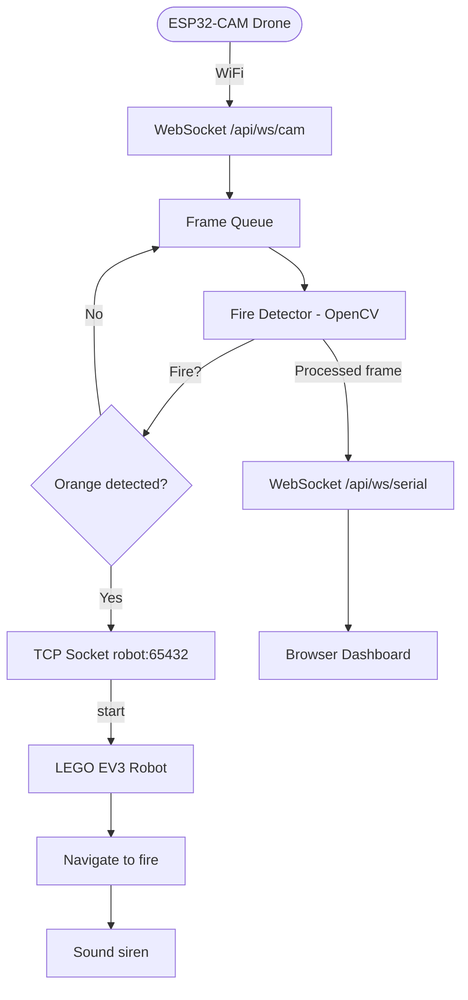

# SIDAV — Fire Detection System with Drone and Computer Vision

[🇺🇸](README.md) [🇧🇷](README.pt.md)

Automated fire detection system using drone-mounted cameras, computer vision (OpenCV), and a ground robot for incident response.

## Architecture

```
┌──────────┐   WebSocket    ┌──────────┐    TCP Socket    ┌──────────┐
│  drone/  │ ─────────────→ │ server/  │ ───────────────→ │  robot/  │
│ ESP32CAM │  JPEG frames   │ OpenCV   │   'start' cmd    │ LEGO EV3 │
│ WiFi     │                │ aiohttp  │                  │ ev3dev   │
└──────────┘                │ Jinja2   │                  └──────────┘
                            └──────────┘
```

| Layer | Directory | Technology | Role |
|-------|-----------|------------|------|
| **Server** | [`server/`](server/README.md) | Python 3, aiohttp, OpenCV | Fire detection, web dashboard, robot orchestration |
| **Drone** | [`drone/`](drone/README.md) | ESP32-CAM, C++, PlatformIO | Aerial image capture and streaming |
| **Robot** | [`robot/`](robot/README.md) | Python 3, LEGO EV3, ev3dev | Ground navigation and siren alert |

## Flowchart



## How It Works

1. **Drone** (ESP32-CAM) captures frames via OV2640 camera and streams them over WiFi via WebSocket.
2. **Server** receives frames, processes them with OpenCV: HSV orange segmentation detects fire.
3. On fire detection, the server sends a TCP `start` command to the **robot**.
4. The **robot** (LEGO EV3) navigates a pre-planned path, verifies with a color sensor, and sounds a siren.
5. Processed video frames are broadcast to a browser dashboard in real-time.

## Technologies

### Server
- **Python 3.10+**
- **aiohttp** — Async web server with WebSocket support
- **OpenCV** — Computer vision and image processing
- **NumPy** — Array operations
- **imutils** — Image utilities (resize)
- **Jinja2** — HTML template rendering

### Drone
- **ESP32-CAM** (AI-Thinker board)
- **PlatformIO** — Build system
- **Arduino Framework**
- **WebSockets (links2004)** — WebSocket client library
- **esp32-camera** — OV2640 camera driver

### Robot
- **LEGO EV3** running ev3dev
- **Python 3** on ev3dev
- **python-ev3dev2** — Motor, sensor, and sound control
- **ALSA aplay** — WAV audio playback

## Project Structure

```
sidav/
├── README.md
├── README.pt.md
├── server/                     ← Central server
│   ├── README.md
│   ├── requirements.txt
│   ├── src/server/
│   │   ├── __init__.py
│   │   ├── config.py           ← All constants and thresholds
│   │   ├── fire_detector.py    ← OpenCV fire detection
│   │   ├── camera_handler.py   ← Frame processing pipeline
│   │   ├── robot_client.py     ← TCP client for EV3
│   │   ├── routes.py           ← HTTP + WebSocket routes
│   │   └── main.py             ← Entry point
│   ├── templates/index.html    ← Dashboard HTML
│   └── tests/
│       ├── test_fire_detector.py
│       └── test_routes.py
├── drone/                      ← ESP32-CAM firmware
│   ├── README.md
│   ├── platformio.ini
│   ├── src/
│   │   ├── main.cpp
│   │   ├── Camera.cpp
│   │   ├── WiFiManager.cpp
│   │   └── WebSocketClient.cpp
│   └── include/
│       ├── Camera.h
│       ├── WiFiManager.h
│       └── WebSocketClient.h
└── robot/                      ← EV3 ground robot
    ├── README.md
    ├── requirements.txt
    └── src/robot/
        ├── __init__.py
        ├── main.py
        ├── server.py           ← TCP listener
        ├── movement.py         ← Motor control
        ├── sound.py            ← Siren playback
        └── sensors/
            └── color_sensor.py ← Color detection
```

## Prerequisites

- **Python 3.10+** with pip (server + robot)
- **OpenCV** (`opencv-python`) and NumPy (server)
- **PlatformIO CLI** or VS Code extension (drone)
- **ESP32-CAM** board with OV2640 camera
- **LEGO EV3** running ev3dev (robot)

## Quick Start

### 1. Clone

```bash
git clone https://github.com/rodriguesxxx/sidav.git
cd sidav
```

### 2. Server

```bash
cd server
pip install -r requirements.txt
PYTHONPATH=src python3 -m server.main
```

API available at `http://localhost:8080`.

### 3. Drone

```bash
cd drone
# Edit WiFi credentials in src/main.cpp
pio run --target upload
pio device monitor
```

### 4. Robot

```bash
# Copy files to EV3
scp -r robot/src robot@192.168.0.100:~/

# On the EV3:
cd ~/src
python3 -m robot.main
```

## Running Tests

```bash
cd server
pip install pytest pytest-aiohttp
PYTHONPATH=src python3 -m pytest tests/ -v
```