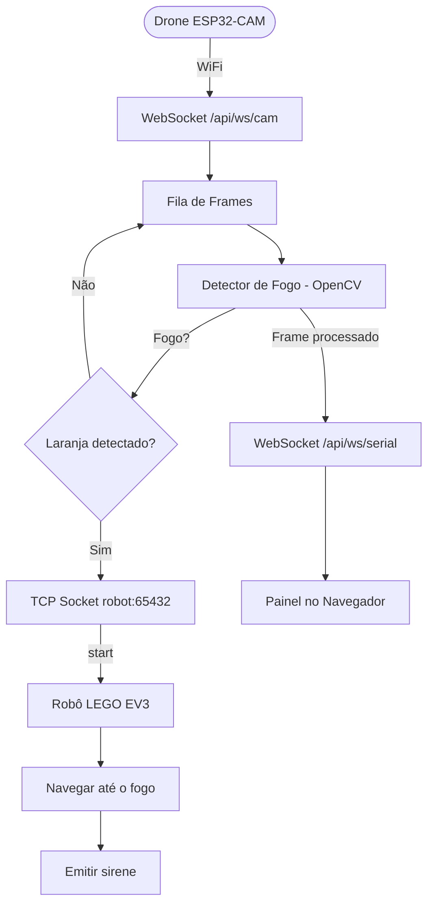

# SIDAV — Sistema de Detecção de Incêndios com Drone e Visão Computacional

[🇺🇸](README.md) [🇧🇷](README.pt.md)

Sistema automatizado de detecção de incêndios utilizando drone com câmera, visão computacional (OpenCV) e robô terrestre para resposta a incidentes.

## Arquitetura

```
┌──────────┐   WebSocket    ┌──────────┐    TCP Socket    ┌──────────┐
│  drone/  │ ─────────────→ │ server/  │ ───────────────→ │  robot/  │
│ ESP32CAM │  Frames JPEG   │ OpenCV   │  comando 'start' │ LEGO EV3 │
│ WiFi     │                │ aiohttp  │                  │ ev3dev   │
└──────────┘                │ Jinja2   │                  └──────────┘
                            └──────────┘
```

| Camada | Diretório | Tecnologia | Papel |
|--------|-----------|------------|-------|
| **Servidor** | [`server/`](server/README.md) | Python 3, aiohttp, OpenCV | Detecção de fogo, painel web, orquestração do robô |
| **Drone** | [`drone/`](drone/README.md) | ESP32-CAM, C++, PlatformIO | Captura e transmissão de imagens aéreas |
| **Robô** | [`robot/`](robot/README.md) | Python 3, LEGO EV3, ev3dev | Navegação terrestre e alerta sonoro |

## Fluxograma



## Como Funciona

1. O **drone** (ESP32-CAM) captura frames via câmera OV2640 e transmite por WiFi via WebSocket.
2. O **servidor** recebe os frames e processa com OpenCV: segmentação HSV laranja detecta fogo.
3. Ao detectar fogo, o servidor envia um comando TCP `start` para o **robô**.
4. O **robô** (LEGO EV3) navega por uma rota pré-planejada, verifica com sensor de cor e emite uma sirene.
5. Os frames processados são transmitidos em tempo real para um painel no navegador.

## Tecnologias Utilizadas

### Servidor
- **Python 3.10+**
- **aiohttp** — Servidor web assíncrono com suporte a WebSocket
- **OpenCV** — Visão computacional e processamento de imagem
- **NumPy** — Operações com arrays
- **imutils** — Utilitários de imagem (redimensionamento)
- **Jinja2** — Renderização de templates HTML

### Drone
- **ESP32-CAM** (placa AI-Thinker)
- **PlatformIO** — Sistema de build
- **Arduino Framework**
- **WebSockets (links2004)** — Biblioteca cliente WebSocket
- **esp32-camera** — Driver da câmera OV2640

### Robô
- **LEGO EV3** rodando ev3dev
- **Python 3** no ev3dev
- **python-ev3dev2** — Controle de motores, sensores e som
- **ALSA aplay** — Reprodução de áudio WAV

## Estrutura do Projeto

```
sidav/
├── README.md
├── README.pt.md
├── server/                     ← Servidor central
│   ├── README.md
│   ├── requirements.txt
│   ├── src/server/
│   │   ├── __init__.py
│   │   ├── config.py           ← Constantes e limiares
│   │   ├── fire_detector.py    ← Detecção de fogo com OpenCV
│   │   ├── camera_handler.py   ← Pipeline de processamento
│   │   ├── robot_client.py     ← Cliente TCP para o EV3
│   │   ├── routes.py           ← Rotas HTTP + WebSocket
│   │   └── main.py             ← Ponto de entrada
│   ├── templates/index.html    ← HTML do painel
│   └── tests/
│       ├── test_fire_detector.py
│       └── test_routes.py
├── drone/                      ← Firmware do ESP32-CAM
│   ├── README.md
│   ├── platformio.ini
│   ├── src/
│   │   ├── main.cpp
│   │   ├── Camera.cpp
│   │   ├── WiFiManager.cpp
│   │   └── WebSocketClient.cpp
│   └── include/
│       ├── Camera.h
│       ├── WiFiManager.h
│       └── WebSocketClient.h
└── robot/                      ← Robô terrestre EV3
    ├── README.md
    ├── requirements.txt
    └── src/robot/
        ├── __init__.py
        ├── main.py
        ├── server.py           ← Servidor TCP
        ├── movement.py         ← Controle de motores
        ├── sound.py            ← Reprodução de sirene
        └── sensors/
            └── color_sensor.py ← Detecção de cor
```

## Pré-requisitos

- **Python 3.10+** com pip (servidor + robô)
- **OpenCV** (`opencv-python`) e NumPy (servidor)
- **PlatformIO CLI** ou extensão VS Code (drone)
- **Placa ESP32-CAM** com câmera OV2640
- **LEGO EV3** rodando ev3dev (robô)

## Início Rápido

### 1. Clone

```bash
git clone <url-do-repo>
cd sidav
```

### 2. Servidor

```bash
cd server
pip install -r requirements.txt
PYTHONPATH=src python3 -m server.main
```

API disponível em `http://localhost:8080`.

### 3. Drone

```bash
cd drone
# Edite as credenciais WiFi em src/main.cpp
pio run --target upload
pio device monitor
```

### 4. Robô

```bash
# Copie os arquivos para o EV3
scp -r robot/src robot@192.168.0.100:~/

# No EV3:
cd ~/src
python3 -m robot.main
```

## Executando Testes

```bash
cd server
pip install pytest pytest-aiohttp
PYTHONPATH=src python3 -m pytest tests/ -v
```

## Licença

MIT